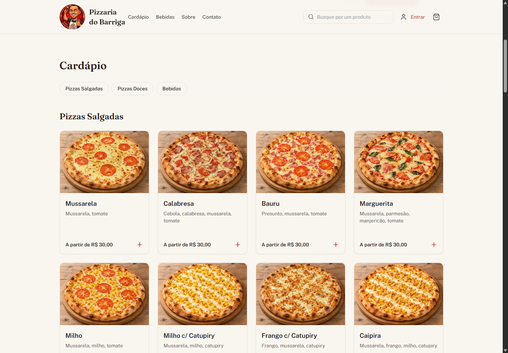
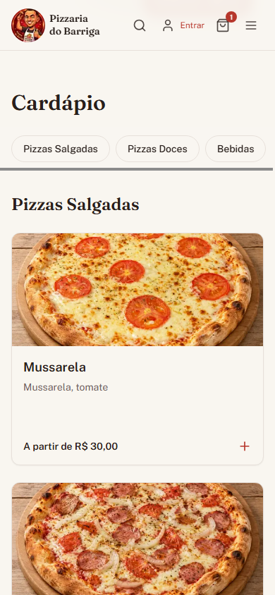
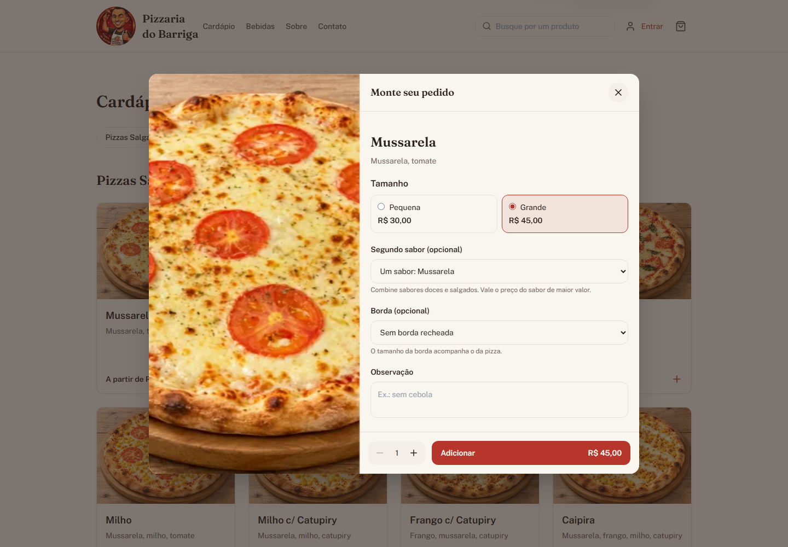
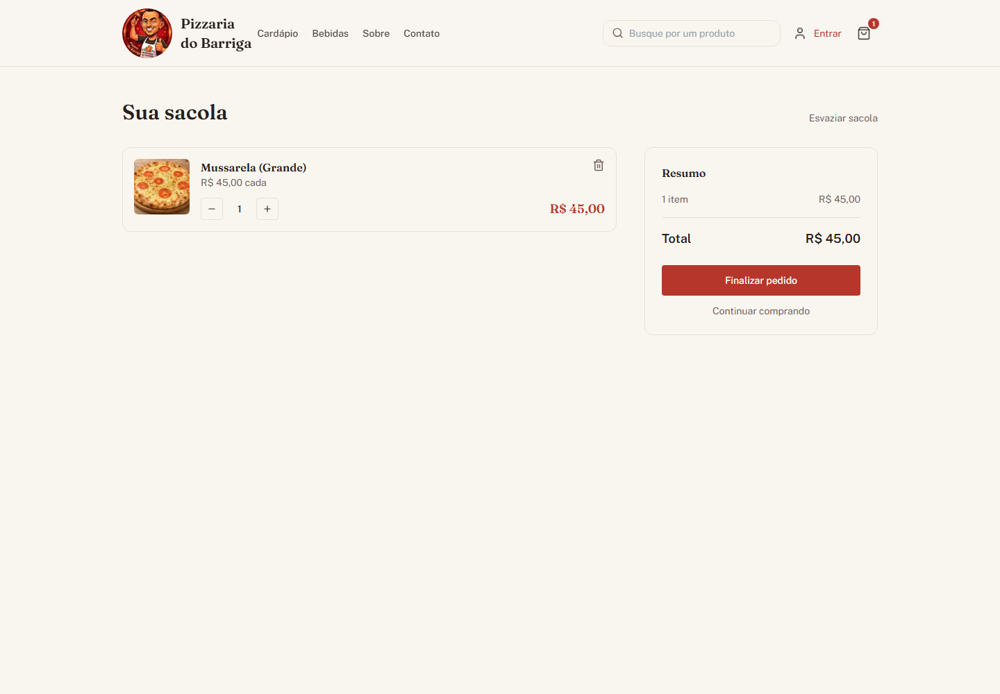
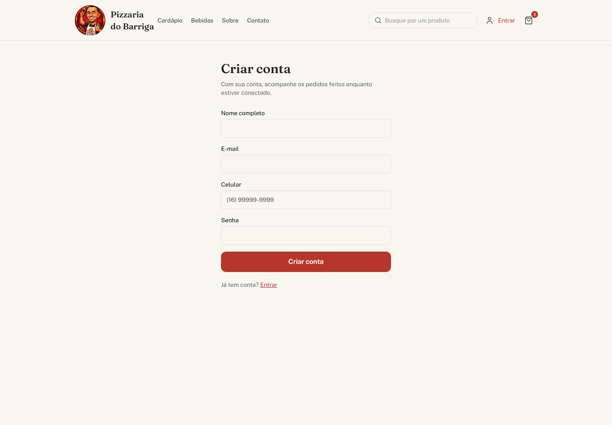
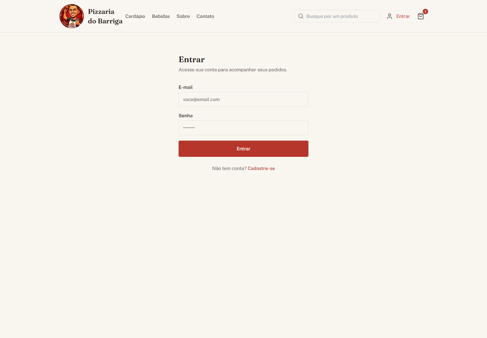

# Manual do Usuário — Pizzaria do Barriga

**Acesso:** https://projeto-pizzaria-frontend-seven.vercel.app.
**Edição:** 13/11/2026. Demonstração acadêmica: não enviar compras comerciais reais.
**Equipe:** Gabriel Freire Flôres (RA 2840482423010) — Marcelo Augusto Oliveira Jose (RA 2840482423043) — Christian de Lima (RA 2840482523031) — Guilherme Fabiano da Silva Gomes (RA 2840482423037).

As imagens abaixo são capturas reais da aplicação publicada, feitas em 13/11/2026, sem acessar contas ou enviar pedidos. Os passos que exigem confirmação ou alteração de cadastro devem ser executados somente em uma demonstração autorizada.

## Para Clientes

### Como consultar o cardápio e buscar um produto

1. Abra o endereço acima e escolha Cardápio.
2. Use Pizzas Salgadas, Pizzas Doces ou Bebidas para navegar.
3. Digite o nome no campo de busca. No celular, toque na lupa para abrir o campo.
4. Consulte ingredientes e preço inicial; o total depende do tamanho e das escolhas.

### Como escolher tamanho, segundo sabor e borda

1. Toque no produto para abrir as opções.
2. Escolha Pequena ou Grande.
3. Se desejar, escolha um segundo sabor, incluindo combinação de doce e salgado. Vale o preço do sabor de maior valor.
4. A borda é opcional, acompanha o tamanho da pizza e acrescenta seu valor ao total.
5. Informe uma observação, ajuste a quantidade e toque em Adicionar.

### Como revisar a sacola

1. Toque no ícone de sacola.
2. Confira itens, quantidades e total.
3. Use + e − para ajustar a quantidade, a lixeira para remover um item ou Esvaziar sacola.
4. Use Finalizar pedido para continuar. Adicionar à sacola ainda não envia o pedido à pizzaria.

### Como criar conta e entrar

1. No ícone da pessoa, escolha Cadastrar ou Entrar.
2. No cadastro, informe nome e sobrenome, e-mail, celular com DDD e senha.
3. Para entrar, informe seu e-mail e senha. Não compartilhe sua senha.
4. A conta de cliente permite finalizar e consultar os próprios pedidos; uma conta de funcionário dá acesso à área interna.

### Como finalizar e acompanhar um pedido

1. Entre com uma conta de cliente antes da confirmação.
2. No fluxo de finalização, revise nome e telefone, escolha entrega ou retirada. Entrega exige endereço; retirada não.
3. Escolha a forma de pagamento exibida. A seleção não cobra cartão nem realiza Pix automaticamente.
4. Revise o resumo antes de confirmar. No site acadêmico, não confirme um pedido sem autorização da equipe.
5. Depois da confirmação autorizada, consulte Meus pedidos no menu da conta. Use Atualizar para buscar o status e o número do pedido para filtrar a lista.
6. A versão atual não apresenta prazo individual de entrega. Somente pedidos da própria conta são mostrados.

Capturas de confirmação e Meus pedidos autenticado: pendentes de homologação autorizada. Não foram usadas imagens de protótipo nem pedidos reais de terceiros para representá-las.

## Para Funcionários

### Como entrar e acompanhar os pedidos

1. Escolha Entrar e use a conta de funcionário fornecida pela administração da equipe.
2. Abra Pedidos na área interna. Novos pedidos são consultados periodicamente.
3. Confira cliente, itens e observações antes de aceitar.
4. Em demonstração autorizada, use Aceitar pedido. O pedido passa de Recebido para Em preparação e fica associado ao funcionário responsável.
5. Avance na ordem oferecida pela tela: Saiu para entrega e Entregue. O sistema não permite pular etapas ou retroceder.

### Como cadastrar ou editar um produto

1. Abra Produtos e escolha Novo produto ou o botão de edição do produto desejado.
2. Preencha nome, tamanho, preço e categoria; revise descrição, disponibilidade e ingredientes aplicáveis.
3. Caso queira uma foto, selecione JPG, PNG ou WebP de até 3 MiB. Arquivos inválidos são recusados.
4. Salve somente se a alteração estiver autorizada. Editar sem enviar outra foto mantém a imagem atual.
5. Um produto usado em pedidos pode ter a exclusão bloqueada para preservar o histórico; nesse caso, use a disponibilidade para retirá-lo do cardápio.

### Como gerenciar a equipe

1. Abra Equipe e use Novo funcionário ou a edição de um cadastro existente.
2. Revise os dados e o estado ativo antes de salvar; informe senha nova somente quando necessário.
3. Essas ações exigem conta de funcionário autorizada. Não use dados pessoais reais em demonstrações públicas.

Capturas da área interna publicada: pendentes de acesso autenticado autorizado, com dados pessoais ocultados. As instruções refletem o sistema existente, mas não representam um novo teste de gravação em produção.

## Para a Gerência

O Documento de Visão prevê Gerente. Nesta versão não existe uma conta com permissões gerenciais separadas: tarefas de produtos e equipe estão na área de funcionário autorizado. Não há painel de faturamento, vendas por período, produtos mais vendidos ou exportação CSV. A equipe deve informar essa limitação na demonstração e no aceite.

## Perguntas frequentes

**Por que o cardápio está carregando?**
Aguarde a resposta e use a tentativa novamente oferecida na tela. Se persistir, avise a equipe; não crie pedidos repetidos.

**Posso finalizar sem entrar?**
Não. A versão atual exige uma conta de cliente para confirmar o pedido.

**Meu pedido mudou de status sozinho na tela?**
Em Meus pedidos, toque em Atualizar. A atualização periódica pertence à lista interna dos funcionários.

**A forma de pagamento já realiza a cobrança?**
Não. Ela apenas registra a opção escolhida; não há pagamento eletrônico integrado.

**Meu produto está na sacola, a pizzaria já recebeu?**
Não. A sacola fica neste navegador até a confirmação autorizada. Limpar os dados do navegador pode apagá-la.

**Errei a senha várias vezes e não consigo entrar. O que fazer?**
Aguarde o tempo informado antes de tentar novamente. Não desative a proteção nem compartilhe credenciais para contorná-la.

**Posso usar este endereço para vender pizzas de verdade?**
Não. Esta publicação é uma demonstração acadêmica, sem operação comercial.
