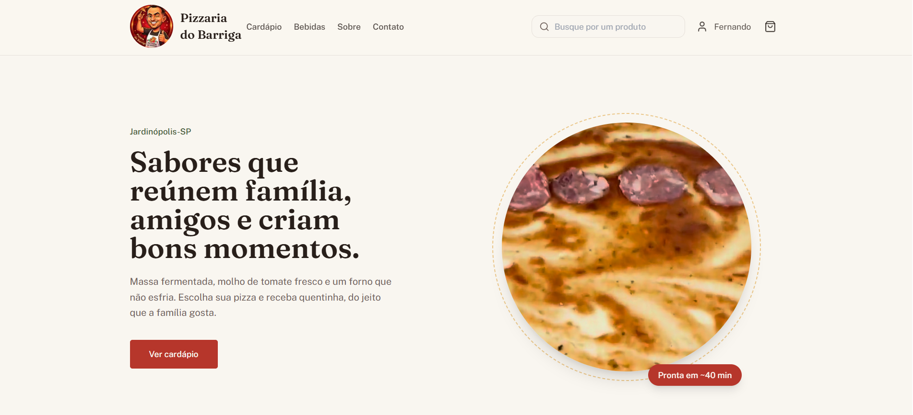
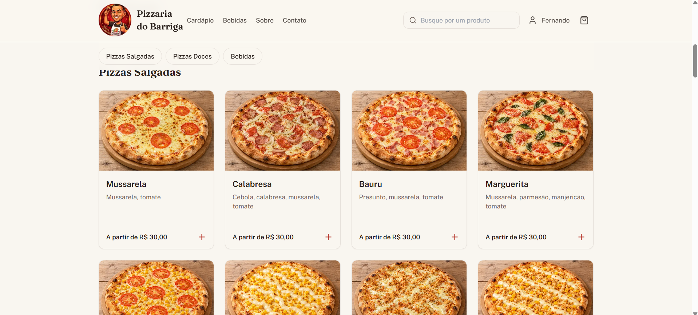
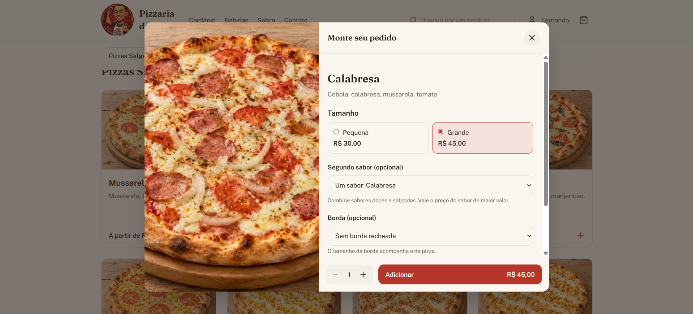
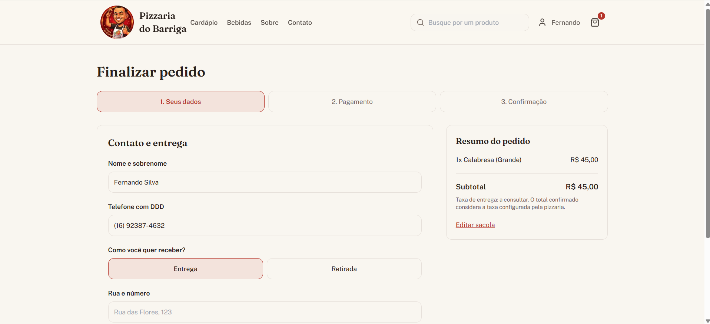
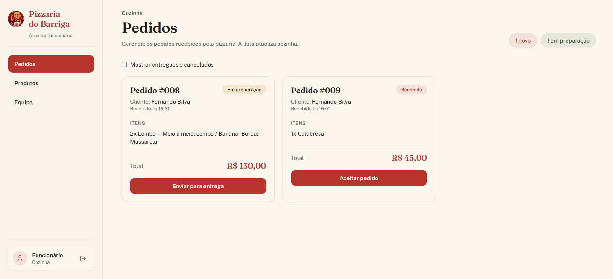
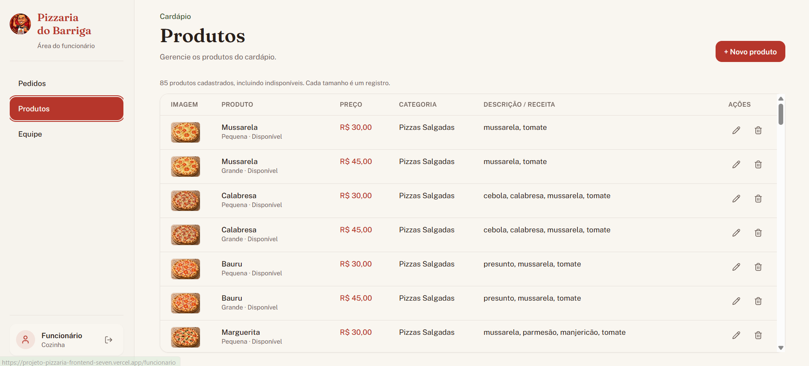

# Ficha da Mostra Virtual — Pizzaria do Barriga

## Nome do projeto

Pizzaria do Barriga

## Frase de destaque

Cardápio digital e pedidos online para conectar clientes à equipe da Pizzaria do Barriga.

## Resumo

O atendimento por WhatsApp e a anotação de pedidos em papel dificultam a organização da pizzaria. A aplicação permite consultar o cardápio, personalizar pizzas, montar a sacola e enviar pedidos após o login. A equipe recebe os pedidos e atualiza seus status em uma área interna. O diferencial técnico reúne preços conferidos pelo servidor, bordas vinculadas aos itens e controle das transições de status, com banco de dados e serviços em nuvem. A publicação é uma demonstração acadêmica, sem operação comercial.

## Equipe

| Nome completo | RA — controle do professor | Papéis exercidos |
|---|---|---|
| Gabriel Freire Flôres | 2840482423010 | Product Owner, desenvolvimento do frontend do cliente, integração entre módulos e preparação de infraestrutura/deploy |
| Marcelo Augusto Oliveira Jose | 2840482423043 | Dados e desenvolvimento backend de produtos, cardápio e pedidos; testes e documentação |
| Christian de Lima | 2840482523031 | Desenvolvimento frontend da área interna e integração de login, equipe, produtos e pedidos |
| Guilherme Fabiano da Silva Gomes | 2840482423037 | Desenvolvimento backend, dados, autenticação, categorias e aceite de pedidos; organização do trabalho da equipe |

## Cliente / PO

- **Organização atendida:** Pizzaria do Barriga, Jardinópolis-SP.
- **Product Owner acadêmico:** Gabriel Freire Flôres.
- **Trilha:** B — cliente real nº 1.
- **Divulgação:** a identificação pública da pizzaria na Mostra Virtual foi autorizada pela Pizzaria do Barriga, conforme informado pela equipe.

## Tecnologias

- **Linguagens:** Python, TypeScript e JavaScript; interface com HTML e CSS.
- **Frontend:** Next.js com App Router, React, Tailwind CSS e Lucide React.
- **Backend:** Flask, psycopg para acesso SQL ao PostgreSQL e Pillow para validar imagens.
- **Banco de dados:** PostgreSQL no Neon Free.
- **Segurança:** sessões Flask, hash de senhas com Werkzeug, proteção CSRF, autorização por perfil e limitação distribuída de login com Upstash Redis Free.
- **Imagens:** Vercel Blob Hobby, com SDK Python `vercel-blob` e módulo `httpx2`.
- **Hospedagem:** frontend e backend em projetos separados na Vercel Hobby; comunicação por proxy `/api` do Next.js.
- **Versionamento:** Git e GitHub, com branches e revisão por Pull Request.
- **Testes e CI:** pytest, pytest-flask, testes Node.js, TypeScript e ESLint. Na versão revisada, a execução é local; não há pipeline automático de CI versionado.

## Links

- **Vídeo de demonstração:** [Pizzaria do Barriga — vídeo da entrega](https://youtu.be/pi3GtfWC59g).
- **Deploy público:** https://projeto-pizzaria-frontend-seven.vercel.app
- **Backend:** https://projeto-pizzaria-backend-xi.vercel.app
- **Repositório:** https://github.com/Gabrielfreireflores/Projeto-pizzaria
- **Manual do usuário:** [manual-do-usuario.md](manual-do-usuario.md).

## Capa

## Capturas de tela

### 1. Página inicial

### 2. Cardápio

### 3. Personalização da pizza

### 4. Finalização do pedido

### 5. Pedidos na área do funcionário

### 6. Produtos na área do funcionário

## Aprendizado da equipe

Aprendemos a nos organizar como uma equipe de desenvolvimento, dividir responsabilidades e integrar entregas. Entendemos a importância de ouvir o cliente, esclarecer seus critérios de aceite e ajustar prioridades. Também aprendemos a acompanhar as novidades do mercado e avaliar tecnologias, segurança e custos para adequar a solução às necessidades do projeto.
